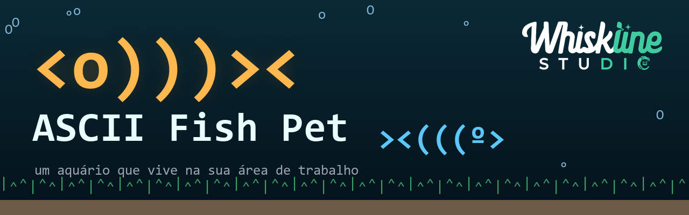
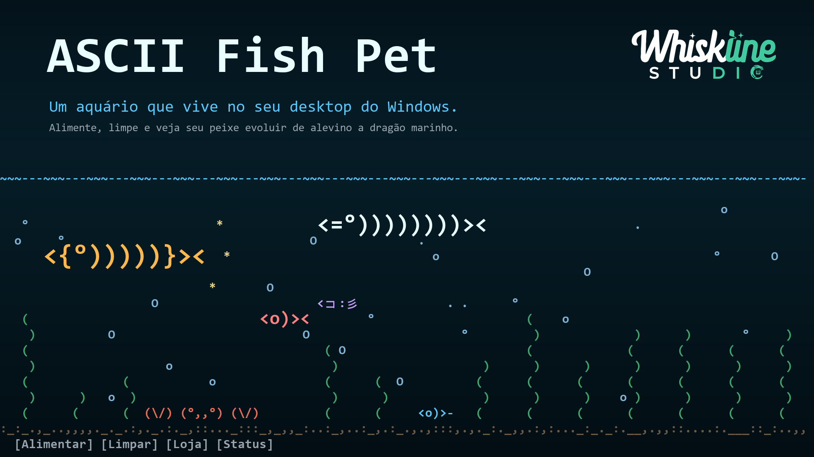

<p align="center">
  
</p>

# ASCII Fish Pet

> Um aquário em arte ASCII que vive no seu desktop do Windows.

```
        °   o                         .
   <o))))><        ~~~~~~~~~~~~~~~~~~~~~~~~~~~~~~~~~~~~~~
        (    (\/) (°,,°) (\/)    <コ:彡      (     )
 ~~~~~~(~~~~~~~~~~~~~~~~~~~~~~~~~~~~~~~~~~~~~~~~~(~~~~~~)~~~
```

Uma faixa transparente na largura da tela, logo acima da barra de tarefas, com água, plantas, bolhas e um peixe feito de caracteres que nada, come, pula para fora d'água e evolui conforme você cuida dele. O fundo é transparente e os cliques atravessam a janela, então ele não atrapalha o que você está fazendo.

Feito e distribuído pela **Whiskline Studio**.



---

## Recursos

- **Aquário no desktop:** janela transparente e sem bordas, encaixada acima da taskbar, com click-through (só o peixe, a sujeira e o painel de controle capturam o mouse).
- **Vive na bandeja do Windows:** não aparece na barra de tarefas. Menu no ícone: mostrar/esconder, modo widget, sempre no topo, reencaixar e sair.
- **Modo widget:** fica sob os apps e sobre o papel de parede, e sobrevive ao **Win+D**. Ou ligue o pin (**Sempre no topo**) para o aquário ficar sempre visível.
- **Animação a 60 FPS:** física em ponto flutuante, corpo do peixe ondulando, cauda, bolhas, plantas e superfície da água ondulantes.
- **O peixe pula para fora da água:** sozinho de vez em quando, para pegar comida que está caindo e quando você clica perto dele.
- **Cuidados:** fome, humor e limpeza. Alimente, limpe a sujeira e interaja para ganhar XP e pérolas.
- **Progressão:** níveis e evolução do peixe (Alevino → Peixe Jovem → Adulto → Peixe-anjo → Tubarão → Dragão Marinho), conquistas e tempo offline justo (o peixe nunca "morre").
- **Loja:** 5 temas de cor, 8 cores de peixe (incluindo arco-íris animado), 3 tipos de ração, decorações e companheiros.
- **Companheiros animados:** peixinho, caranguejo `(\/) (°,,°) (\/)` e lula `<コ:彡`.

## Como usar

| Ação | Como |
|---|---|
| Alimentar onde quiser | **Ctrl + clique** na água |
| Alimentar perto do peixe | botão **[Alimentar]** do dock |
| Alimentar no X do mouse (de qualquer lugar) | **Ctrl + Alt + F** |
| Limpar tudo | botão **[Limpar]** ou tecla `C` (com a janela em foco) |
| Limpar uma sujeira | clique nela |
| Carinho no peixe | clique nele |
| Fazer o peixe pular | clique com o X do mouse perto do X do peixe |
| Abrir menu (Status, Loja, Opções) | ícone ⚙ do dock |
| Fixar acima dos apps | ícone do pin do dock (ou menu da bandeja) |
| Esconder / sair | **X** do dock esconde na bandeja; **Sair** fica no menu do ícone da bandeja |

O dock de controles fica no canto inferior esquerdo e só aparece quando o mouse chega perto (configurável).

### Como ganhar pérolas
- Alimentar com a fome abaixo de 60: +1 por floco.
- Subir de nível: 10 + nível.
- Limpar 3 ou mais sujeiras de uma vez: +1.
- Cada conquista: +15.

### Modo debug
Em **Opções → Modo debug (testes)** há atalhos para testar tudo: +pérolas, +níveis, desbloquear a loja inteira, sujar a água, forçar pulo, mudar a fome e resetar o progresso.

## Instalação

Baixe e execute o **`AsciiFishPet-Setup.exe`**. O instalador:

- não pede administrador (instala em `%LOCALAPPDATA%\Programs\ASCII Fish Pet`);
- vem com **"Iniciar com o Windows" marcado** (dá para desmarcar) e atalho opcional na área de trabalho;
- fecha o app se ele estiver rodando e atualiza por cima **sem perder o progresso**;
- ao desinstalar, pergunta se você quer apagar também o progresso salvo.

> O Windows pode mostrar um aviso do SmartScreen porque o app ainda não tem assinatura digital: clique em **Mais informações → Executar assim mesmo**.

## Requisitos

- Windows 10 ou 11 (64 bits).
- Em máquinas sem o Visual C++ runtime, instale o *Microsoft Visual C++ Redistributable x64*.

## Dados salvos

O progresso e as configurações ficam em `%APPDATA%\com.asciifish\ascii_fish_pet\` (arquivo `ascii_fish_save.json`).
Há também um `events.log` simples, que registra quando a janela é escondida ou minimizada.

## Desenvolvimento

Requer Flutter (testado com 3.47) com suporte a Windows desktop.

```bash
flutter pub get
flutter run -d windows        # desenvolvimento
flutter test                  # testes do motor e da progressão
```

### Build e instalador

Na raiz do projeto (PowerShell ou cmd):

```powershell
.uild       # flutter clean + pub get + build windows (release)
.
elease     # tudo isso + gera o instalador (Inno Setup)
```

Os dois aceitam `-SemClean` para pular o `flutter clean` (ex.: `.
elease -SemClean`). Fecham o app antes, se estiver aberto.

- O app fica em `build\windowsd
unner\Release\` (para distribuir sem instalador, **leve a pasta inteira**: o `.exe` sozinho não abre).
- O instalador fica em `installer\Output\AsciiFishPet-Setup.exe`, com a versão do `pubspec.yaml`. Requer o [Inno Setup 6](https://jrsoftware.org/isinfo.php) (`winget install JRSoftware.InnoSetup`).

### Identidade visual

Ícone, banners e imagens são gerados por script (requer Python com Pillow):

```bash
python tools/gen_identity.py
```

Gera `docs/banner.png`, `docs/promo.png`, o ícone do app (`.ico`/`.png`) e as imagens do instalador em `installer/assets/`, e copia o ícone para o `.exe` e a bandeja.

> **Dicas**
> - Feche o app pela bandeja (**Sair**) antes de rebuildar, senão o linker não consegue gravar o `.exe` (erro `LNK1104`).
> - O OneDrive pode apagar `windows\flutter\ephemeral\`. Se o build reclamar de `cpp_client_wrapper`, rode `flutter clean`, `flutter pub get` e builde de novo. O ideal é manter o projeto fora do OneDrive.

### Estrutura

```text
lib/
├── main.dart                         # inicialização (janela, bandeja, click-through)
├── app/                              # app, tema e GameController (liga tudo)
├── core/
│   ├── models/                       # peixe, partículas, progresso, loja, temas, sprites
│   ├── simulation/                   # AquariumEngine (física/IA) e ProgressionService
│   └── storage/                      # save em JSON (path_provider)
├── platform/                         # janela, bandeja, click-through, camada de desktop
└── ui/                               # painter (CustomPainter), dock, menu e tela
windows/runner/                       # runner Win32 (bloqueia minimizar/maximizar)
test/                                 # testes de unidade do motor
installer/                            # AsciiFishPet.iss (Inno Setup) e assets/ (logo, ícone, banners)
scripts/                              # build.ps1 e release.ps1 (usados por .uild e .
elease)
tools/                                # gen_identity.py (ícone e banners)
docs/                                 # banner e imagem de divulgação
```

O motor de simulação (`core/`) é Dart puro, separado da renderização e da camada de janela do Windows.

## Roadmap

Veja o [TODO.md](TODO.md) para o detalhamento. Resumo do que vem a seguir:

- [x] **Identidade visual:** ícone do peixe ASCII, banners e imagem de divulgação.
- [x] **Instalador** (Inno Setup) com "Iniciar com o Windows" marcado por padrão.
- [ ] Opção dentro do app para ligar/desligar "Iniciar com o Windows".
- [ ] **Otimização de CPU** (hoje cerca de 3% parado).
- [ ] **Novo visual de Status e Loja.**
- [ ] Dar uso ao humor, balancear economia e progressão, fonte monoespaçada embarcada.

## Créditos

Criado e distribuído pela **Whiskline Studio**.
